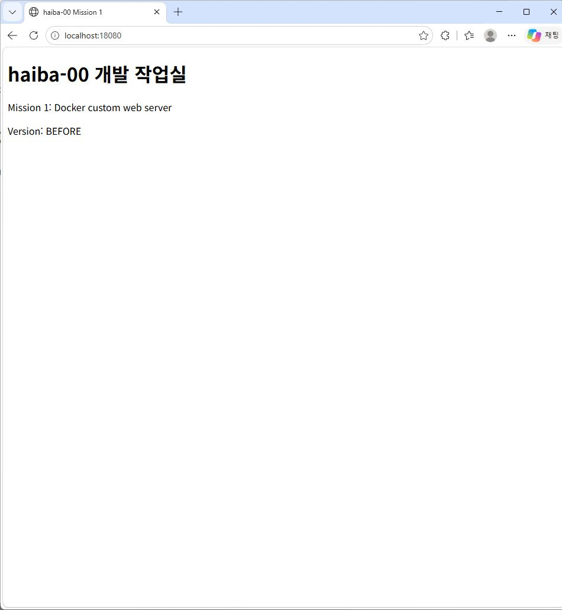
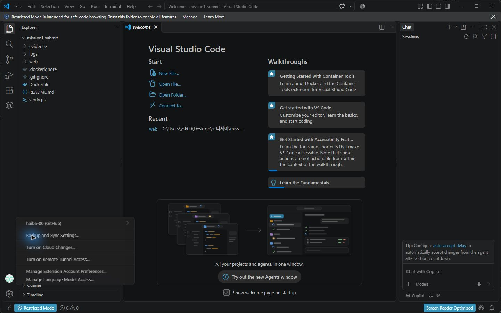

# 미션1 — haiba-00 개발 작업실

## 목표 및 환경

Linux CLI와 권한을 익히고, NGINX 커스텀 이미지를 빌드하여 포트 매핑, 바인드 마운트, 볼륨 영속성을 실제 출력으로 검증했다.

Windows / PowerShell / Git 2.56.0.windows.4 / Docker 29.9.2 / Docker Desktop Linux engine / Ubuntu 24.04 / nginx:alpine.

**실제 stdout/stderr와 종료 코드를 직접 수집한 [최신 실행 증거](logs/actual-output.md)가 평가용 원본이다.** 기존 트랜스크립트는 외부 명령 출력 누락 문제로 대체했다. 아래 요약은 실제 실행에서 발췌했다.

## 요구사항과 증거

|항목|결과|증거|
|---|---|---|
|터미널·경로·복사·이동·삭제|완료|최신 실행 증거의 Ubuntu 절|
|파일·폴더 chmod 전후|완료|아래 권한 출력 및 최신 실행 증거|
|Docker 버전·데몬|완료|실제 --version, info 출력|
|hello-world|완료|전체 환영 메시지|
|images/ps/logs/stats|완료|실제 이미지·컨테이너·운영 출력|
|Dockerfile 빌드|완료|레이어와 DONE, 이미지 이름 출력|
|포트 접속|완료|HTTP 헤더·본문 및 주소창 캡처|
|바인드 마운트|완료|동일 컨테이너 BEFORE→AFTER 응답|
|볼륨 영속성·백업·복원|완료|삭제 전후 및 복원 후 cat 출력|
|Git/GitHub/VS Code|완료|remote/원격 SHA 및 로그인 캡처|
|폴더 구조·트러블슈팅|완료|아래 설명|

## 실제 결과 발췌

```text
> docker --version
Docker version 29.9.2, build a82e528
> docker info --format 'ServerVersion={{.ServerVersion}}; OSType={{.OSType}}; Driver={{.Driver}}'
ServerVersion=29.9.2; OSType=linux; Driver=overlayfs
> docker run --rm hello-world
Hello from Docker!
This message shows that your installation appears to be working correctly.
```

info의 위 세 필드는 전체 실제 결과에서 발췌했다. 정확한 명령, 나머지 필드 및 전체 hello-world 메시지는 최신 실행 증거에 있다.

```text
BEFORE
 drwxr-xr-x ... demo       # 755
 -rw-r--r-- ... empty.txt  # 644
AFTER
 drwx------ ... demo       # 700
 -rw------- ... empty.txt  # 600
```

위 권한 요약에서 날짜·소유자·크기는 생략했다. 생략 없는 ls -ld 출력은 최신 실행 증거에 있다. chmod는 성공 시 보통 출력이 없으므로 전후 ls 결과로 검증했다.

## 폴더 구조 및 구성 기준

```text
mission1-workstation/
├── README.md                 # 목표, 원리, 재현, 증거 링크
├── Dockerfile                # NGINX 커스텀 이미지
├── .dockerignore             # Git/로그를 빌드 컨텍스트에서 제외
├── .gitignore                # 토큰·개인키·환경파일 제외
├── web/index.html            # 호스트에서 변경할 정적 페이지
├── verify.ps1                # 최초 환경 구성 실습
├── collect-evidence.ps1      # stdout/stderr 직접 수집
├── logs/actual-output.md     # 최신 전체 실제 명령·출력
├── logs/attach.md            # attach 종료 관찰
├── logs/git-push.md          # 원격 업로드 실제 출력
└── evidence/                 # 브라우저 및 VS Code 캡처
```

실행 소스, 컨테이너 정의, 로그, 화면 증거를 나눠 README 한 곳에서 접근하게 했다. 루트가 빌드 컨텍스트이며 web/만 이미지에 COPY한다.

## 재현 절차

Docker Desktop 실행 후 저장소 루트에서 실행한다. Windows PowerShell 5.1 또는 PowerShell 7을 사용한다.

```powershell
powershell -ExecutionPolicy Bypass -File ./verify.ps1
pwsh -File ./collect-evidence.ps1
```

verify.ps1은 최초 실행용이다. 동일 이름 컨테이너가 있으면 먼저 docker ps -a로 본 실습 이름을 확인한다. 기존 다른 실습 컨테이너를 삭제하지 않는다. collect-evidence.ps1은 verify가 만든 18082/18083 서버를 사용하며 매번 새 볼륨 이름으로 영속성을 검증한다. Linux chmod 실습은 NTFS 대신 컨테이너 내부에서 수행한다. 실제 증거를 재생성하면 로그에 로컬 정보가 포함되지 않는지 점검한다.

포트와 볼륨은 다음처럼 바꿀 수 있다. 아래는 실행 예시이며 실제 수행 증거와 구분한다.

```powershell
$hostPort = 18090
$volumeName = 'haiba00-custom-data'
docker run -d --name haiba00-custom-web -p "${hostPort}:80" haiba00-mission1:verified
curl.exe -i "http://localhost:$hostPort"
docker volume create $volumeName
docker run --rm -v "${volumeName}:/data" ubuntu:24.04 ls -la /data
```

마운트 호스트 경로는 절대 경로를 사용하고 스크립트의 PSScriptRoot에서 계산한다. 컨테이너 내부 경로 /usr/share/nginx/html과 /data는 Linux 절대 경로다. /practice에서 상대 경로 demo는 절대 경로 /practice/demo와 같다.

## 설계와 관찰

NGINX 베이스에 web/을 COPY했다. LABEL은 이미지 식별, APP_ENV는 환경 표기용이다. EXPOSE는 포트 문서화이며 실제 외부 연결은 -p가 담당한다. 컨테이너는 별도 네트워크 네임스페이스를 사용하므로 내부 80번을 호스트의 18082번 등으로 연결해야 한다.

이미지는 실행 템플릿, 컨테이너는 실행 인스턴스다. COPY한 파일은 빌드 시점에 이미지에 고정된다. 호스트 파일을 바꿔도 기존 이미지 내용은 바뀌지 않으며 새 이미지를 빌드해야 한다. 반면 바인드 마운트는 호스트 파일을 직접 읽어 재빌드 없이 BEFORE→AFTER가 반영됐다.

볼륨은 컨테이너와 별도 수명이다. 쓰기 컨테이너 삭제 후 새 컨테이너의 cat /data/proof.txt에서 haiba00-persistent를 다시 읽었다. tar로 백업하고 새 볼륨에 복원한 뒤 같은 내용을 검증했다. 정확한 백업/복원 명령과 실제 출력은 최신 실행 증거에 포함했다.

exec는 실행 중 컨테이너에 새 프로세스를 생성한다. echo 종료 후 sleep infinity 컨테이너가 유지됐다. attach --no-stdin은 주 프로세스 출력을 연결하며 MAIN-FINISHED 출력 후 주 프로세스 종료와 exited 상태를 관찰했다([로그](logs/attach.md)).

r=4, w=2, x=1이며 소유자/그룹/기타 순이다. 644=-rw-r--r--, 600=-rw-------, 755=drwxr-xr-x, 700=drwx------다. 폴더 x는 경로 진입 권한이다.

Git은 로컬 이력 관리, GitHub는 원격 협업 서비스다. 이 저장소만 haiba-00 작성자로 설정했고 전역 설정은 변경하지 않았다. 실제 remote -v와 원격 main SHA는 최신 실행 증거, push 결과는 별도 업로드 로그에 있다.

## 트러블슈팅

1. **출력 누락:** 명령만 남는 로그 발견 → PowerShell 트랜스크립트의 외부 명령 출력 누락 가설 → 기존 파일과 실제 터미널 출력 비교로 확인 → 외부 명령의 stdout/stderr를 2>&1로 직접 수집하고 종료 코드 0과 본문 저장 여부를 확인했다.
2. **권한 명령 인용부호:** stat missing operand → Windows PowerShell 중첩 인용 전달 오류 가설 → 기존 실행에서 실패 확인 → ls -ld로 대체해 BEFORE 644/755, AFTER 600/700을 실제 검증했다.
3. **Docker 연결:** 최초 pipe 없음 → 엔진 미기동 가설 → docker info 실패 → 설치된 Docker Desktop 실행 → 최신 docker info가 Linux 엔진 버전과 드라이버를 반환하여 복구 확인.
4. **한글 깨짐:** 파일 변경 후 문자 손상 → 기본 읽기 인코딩 가설 → 응답 본문으로 확인 → Get-Content -Encoding utf8 적용 → 최신 변경 전후 응답에 한글이 정상 유지됨을 확인했다.
5. **포트 충돌 진단:** 아래 순서로 점유 PID와 프로세스, 컨테이너를 확인한다. 아래는 진단 절차 예시다. 다른 사람 프로세스를 무작정 종료하지 않고 본 실습 컨테이너만 중지하거나 다른 포트를 선택한다.

```powershell
netstat -ano | Select-String ':18082\s'
Get-NetTCPConnection -LocalPort 18082 -State Listen | Select-Object LocalAddress,LocalPort,OwningProcess
Get-Process -Id <위에서_확인한_PID>
docker ps --filter publish=18082
# 본 실습 컨테이너가 점유할 때만 실행:
docker stop haiba00-m1-final-web
# 또는 호스트 포트 18090으로 새 실행 후 curl 포트도 함께 변경
```

## 화면 증거 및 제출

[제출 저장소](https://github.com/haiba-00/mission1-workstation) · 브랜치 main



최초 캡처 포트는 18080, 최신 검증 서버는 18082/18083이다.



토큰·비밀번호·개인키는 제출하지 않는다. 최신 로그의 사용자 경로는 마스킹했다.
