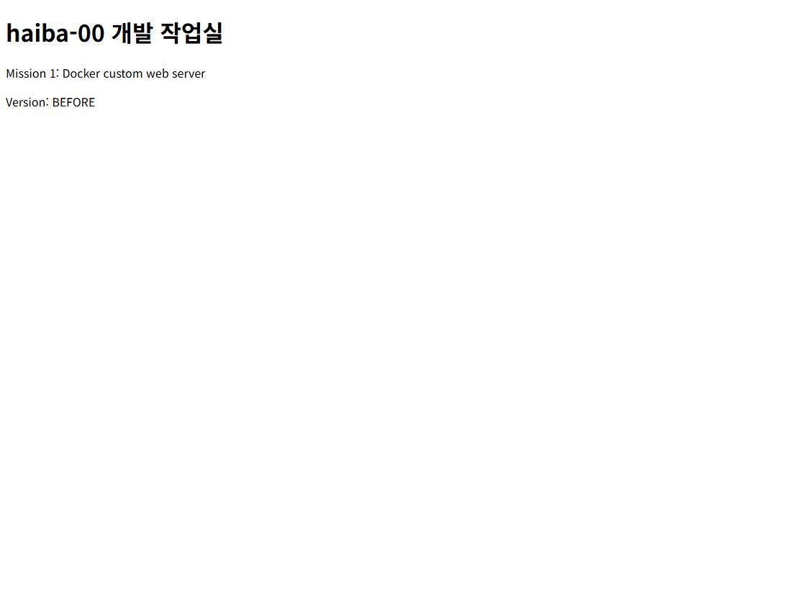

# haiba-00 미션1 개발 작업실

Windows / PowerShell / Git 2.56.0.windows.4 / Docker 29.9.2 (Docker Desktop Linux engine).

## 검증 결과

- [x] 터미널 생성, 이동, 숨김 목록, 복사, 이름변경, 삭제, 파일 읽기
- [x] 파일 644→600, 디렉터리 755→700 권한 실험
- [x] Docker info, hello-world, Ubuntu exec
- [x] NGINX 커스텀 이미지 빌드 및 실행
- [x] 18080, 18081 포트 curl 응답
- [x] 바인드 마운트 BEFORE→AFTER
- [x] 컨테이너 삭제 후 볼륨 데이터 유지
- [x] 저장소별 삼촌 Git 작성자 설정 및 main 브랜치
- [ ] GitHub haiba-00 인증·저장소 업로드, VS Code 연동 증거
- [ ] 주소창 포함 브라우저 캡처

실제 명령과 출력은 [전체 로그](logs/verification.txt), [권한 수정 검증](logs/permissions-fix.txt)에 있다. verify.ps1은 실행 절차다. 기존 haiba00-m1-* 컨테이너가 없는 환경에서 실행한다. 반복 시 본 실습 컨테이너만 확인해 정리하고 web/index.html의 AFTER를 BEFORE로 복원한다. 권한 실습의 stat 명령은 인용부호 오류가 있어 아래 대체 절차를 따른다.

## 재현 명령

```powershell
docker build -t haiba00-mission1:1.0 .
docker run -d --name haiba00-m1-web -p 18080:80 haiba00-mission1:1.0
curl.exe --fail http://localhost:18080
docker exec haiba00-m1-linux bash -lc 'cd /practice; chmod 644 empty.txt; chmod 755 demo; ls -ld empty.txt demo; chmod 600 empty.txt; chmod 700 demo; ls -ld empty.txt demo'
```

전체 마운트 및 볼륨 명령은 로그와 verify.ps1에 있다. 경로는 스크립트 위치로 자동 계산된다. Docker Desktop을 먼저 실행하고 포트 충돌 시 18080/18081 및 curl 포트를 함께 변경한다.

## 원리

NGINX 베이스에 직접 작성한 web/을 COPY했다. LABEL은 이미지 식별, APP_ENV는 환경 표기용이다. EXPOSE 자체는 포트를 공개하지 않으며 -p 18080:80이 호스트와 컨테이너를 연결한다. 이미지는 실행 템플릿, 컨테이너는 실행 인스턴스다.

바인드 마운트는 호스트 변경을 재빌드 없이 즉시 반영했다. 볼륨은 컨테이너와 독립적으로 유지되어 삭제 전후 모두 haiba00-persistent를 읽었다.

exec는 실행 중인 컨테이너에 새 프로세스를 만든다. echo가 끝나도 주 프로세스 sleep infinity는 유지됨을 ps로 확인했다. attach는 주 프로세스 입출력에 연결한다. attach 대화형 실험은 아직 미수행이다.

절대 경로 /practice/demo는 루트 기준이며 /practice에서 상대 경로 demo와 같다. r=4,w=2,x=1이고 소유자/그룹/기타 순이다. 644는 소유자 읽기쓰기, 나머지 읽기다. 755는 소유자 전체, 나머지 읽기/실행이다. 폴더 x는 진입 권한이다. NTFS와 혼동하지 않도록 Linux 컨테이너에서 실험했다.

Git은 로컬 이력 관리, GitHub는 원격 협업 서비스다. 작성자와 원격 인증은 별개다. 삼촌 user.name/email은 이 저장소에만 적용했다. 전역 설정과 기존 사용자 인증은 변경하지 않았다.

## 트러블슈팅

1. Docker pipe 없음 → 엔진 미기동 가설 → docker info 실패 확인 → 사용자 설치 경로의 Docker Desktop 실행 후 연결 성공. 실행 환경 pipe 접근 제한은 권한 있는 터미널에서 해결.
2. stat missing operand → PowerShell 중첩 따옴표 전달 오류 가설 → 최초 로그 실패 확인 → chmod와 ls -ld로 전후 재검증 성공.
3. AFTER 변경 중 한글 깨짐 → Windows PowerShell 기본 읽기 인코딩 가설 → 응답에서 손상 확인 → UTF-8 파일 복원. 스크립트의 Get-Content에는 -Encoding utf8을 지정해야 한다.

## 남은 작업

기존 GitHub 인증이 다른 사용자여서 업로드하지 않았다. haiba-00으로 별도 인증 후 삼촌 저장소에 업로드하고 VS Code 및 브라우저 증거를 추가해야 제출 완료다. 로그에 비밀번호/토큰/개인키를 넣지 않는다.

## 웹 접속 화면



이 캡처는 페이지 본문이며 주소창은 포함하지 않는다. 포트 주소와 응답은 검증 로그에서 확인한다. 공개용 로그는 로컬 사용자 경로, 이메일, 기존 타 실습 컨테이너 행을 마스킹/제외했다.

